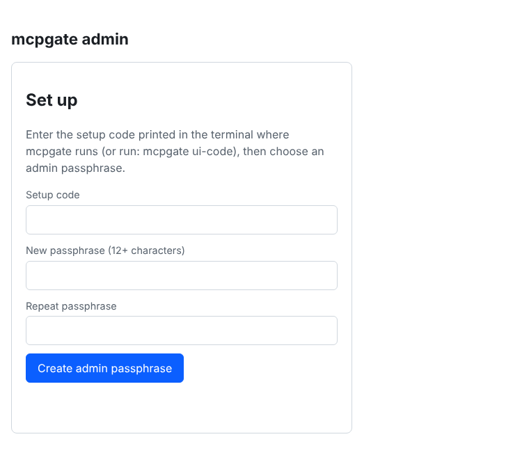
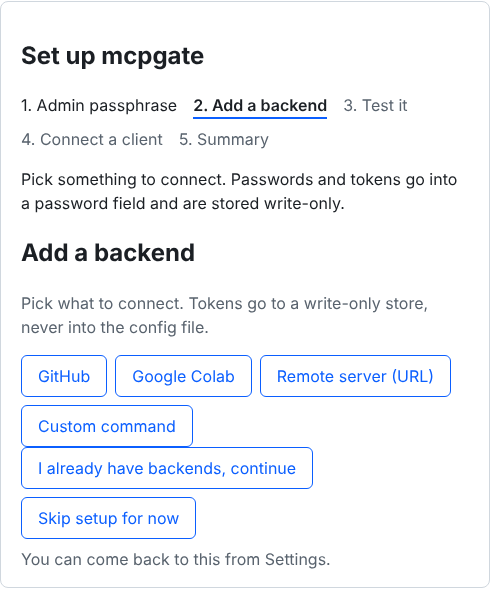
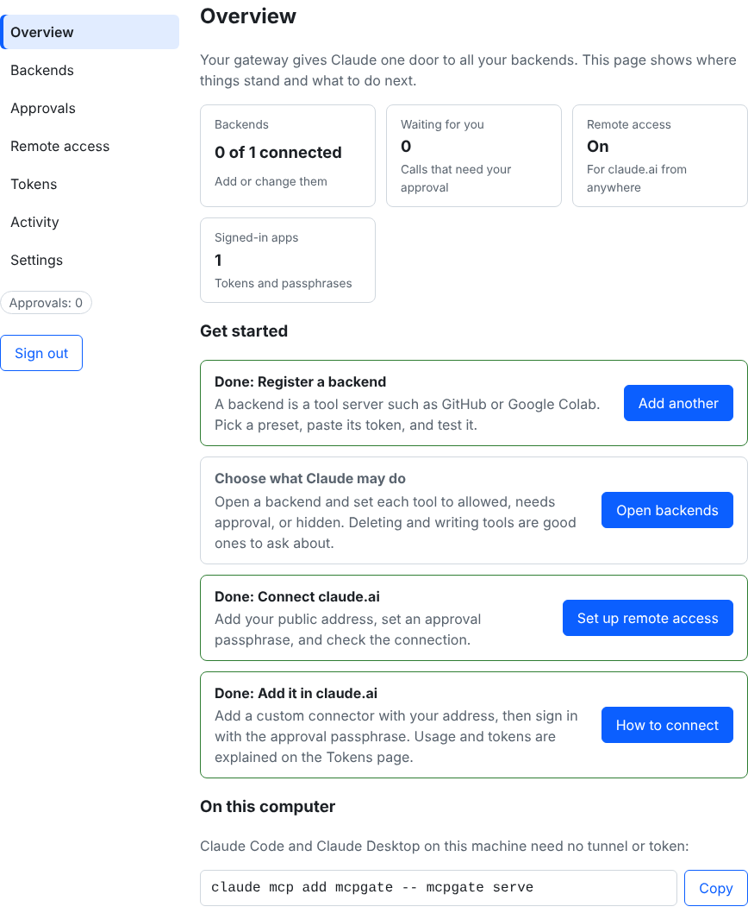
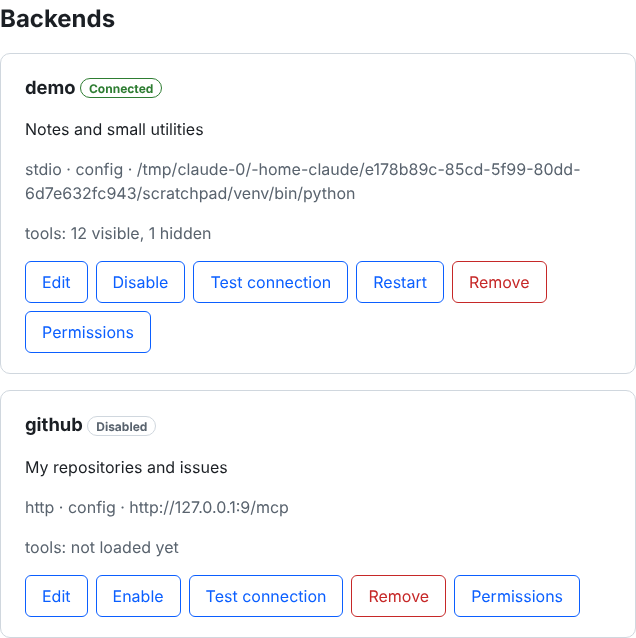
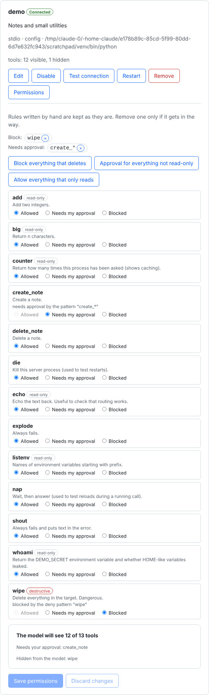
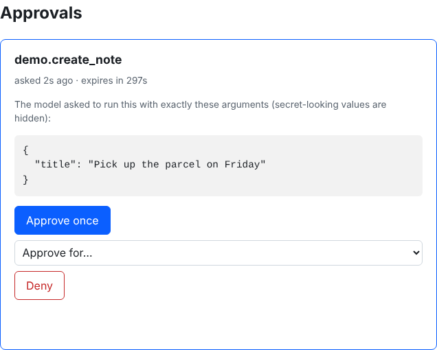
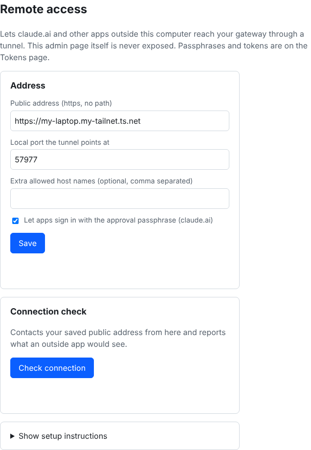
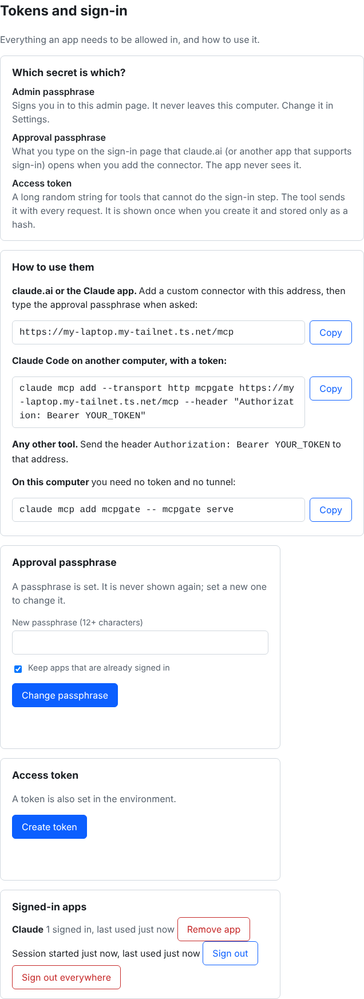

# mcpgate

One MCP server that routes to many MCP servers.

You connect your AI client to `mcpgate` once. Behind it sit any number of other MCP servers (GitHub,
files, mail, remote servers, or ones you write yourself). Instead of loading hundreds of tool
definitions into the model's context, the gateway exposes five small tools and lets the model **search
for the tool it needs**, then call it.

```
 AI client ──MCP──►  mcpgate  ──┬─ stdio  ► npx @modelcontextprotocol/server-github
 (Claude, etc.)    5 meta-tools ├─ http   ► https://example.com/mcp
                    policy,     ├─ sse    ► https://legacy.example/sse
                    cache,      └─ custom ► ~/.config/mcpgate/custom/notes.py
                    audit log
```

## Why

- **Smaller context.** Ten servers can mean 200+ tool schemas in every request. Here the client sees five tools.
- **One place for control.** Allow/deny lists, approval for risky tools, secrets kept in one place, one audit log.
- **Your own servers are easy.** Drop a `.py` file in a folder; it becomes a backend.

## Install

Needs Linux with systemd and Python 3.11+ (the installer fetches one with uv if needed).

```bash
git clone https://github.com/Piyushchy/MCP.git
cd MCP
./install.sh
```

This installs the `mcpgate` command, starts a background service that survives logout and reboot, and prints the
admin address and a one-time setup code. Details, options, upgrade and uninstall: [docs/install.md](docs/install.md).

## Admin UI

Everything below can be done in the browser; the terminal is optional after install. The admin page is served at
**`http://127.0.0.1:8767`** and **only** on the loopback address of the computer running mcpgate. There is no
setting, flag or environment variable that exposes it, and the public gateway port has no admin code at all
(admin paths answer 404 there).



**First run.** Open the address, enter the setup code from the installer (`mcpgate ui-code` prints a new one),
and choose an admin passphrase of at least 12 characters. A guided setup then asks you to pick a backend (GitHub
or Google Colab presets, or your own), enter its secret, test it, and shows the line to connect your AI client.
It opens once on a fresh install and can be reopened from **Settings**.



The page is a dashboard with a menu on the left (a row at the top on a phone):

| Page | What you do there |
|---|---|
| **Overview** | Where things stand (backends connected, approvals waiting, remote access, signed-in apps) and a four-step "Get started" list: register a backend, choose what Claude may do, connect claude.ai, add it in claude.ai. |
| **Backends** | Each backend with whether it is reachable, a plain-language reason and hint if not, and Test, Enable, Disable, Remove. Open **Edit** to change a backend's address, command or headers, or to replace its token without removing it. Open **Permissions** on a backend to set each tool to allowed, needs approval (`confirm`) or hidden (`deny`) from the real tool list. **Add a backend** is on the same page: presets, a remote URL (HTTP or SSE), or a command, with fields for environment variables, headers and secrets. |
| **Credentials** | The tokens and keys mcpgate uses to sign in to your backends (for example a GitHub token): which backends use each, replace or delete. Values are never shown again. |
| **Approvals** | Pending requests for tools that need approval, showing the exact arguments. Approve once, for a while, or deny. |
| **Remote access** | Public address, the sign-in switch for claude.ai, a connection check, and setup instructions for Tailscale Funnel or Cloudflare. |
| **Tokens** | Explains the three secrets (admin passphrase, approval passphrase, access token), how to use each with claude.ai, Claude Code and other tools, and manages the approval passphrase, the access token and the signed-in apps (sign out one or all). |
| **Activity** | The audit log with filters, paging and download. Log size and rotation are set here. |
| **Settings** | Change the admin passphrase, reopen the guided setup, and the switch for custom command backends. |



| Backends | Permissions |
|---|---|
|  |  |
| **Approvals** | **Remote access** |
|  |  |



All pages follow the system light or dark theme; dark versions are in [docs/screenshots](docs/screenshots). The page works with a keyboard alone, at phone width, and with reduced motion; `tests/test_a11y_browser.py` checks contrast, labels, focus outlines and overflow (set `MCPGATE_AXE` to an axe-core file to add axe).

**Secrets.** Values you enter (tokens, API keys) are stored in `~/.config/mcpgate/secrets.json` (mode 600) and
referenced as `${NAME}` in backend settings. They are write-only: the page can replace or delete one but can never
show it again, and they are kept out of logs, the audit log and error messages. They are **plaintext on disk**
(protected by file permissions, not encrypted), like most config files that hold tokens.

**Changes apply live.** Saving in the UI, or editing `config.toml` by hand, is picked up within about two seconds
(or at once on `SIGHUP`). A config with an error never replaces the working one; the page shows what is wrong.

**Things that need you to type the passphrase again.** Anything that can run code on your computer (adding a
command backend, changing a command) asks for your admin passphrase again. Custom commands are available by default; you can turn the whole
feature off in Settings.

**From another computer.** The admin page stays on loopback; forward it over SSH
(`ssh -L 8767:127.0.0.1:8767 you@server`) and browse to `http://127.0.0.1:8767` on your laptop.

**Lost the admin passphrase?** `mcpgate auth clear-admin`, then `mcpgate ui-code` for a new setup code.

**Where things are stored**

| What | Where |
|---|---|
| Settings | `~/.config/mcpgate/config.toml` |
| Secrets | `~/.config/mcpgate/secrets.json` (600) |
| Admin passphrase hash, approval passphrase, token | `~/.config/mcpgate/auth.json` (600, hashed) |
| Custom backends | `~/.config/mcpgate/custom/` |
| Signed-in apps (hashed tokens) | `~/.local/state/mcpgate/oauth.json` (600) |
| Audit log | path from `audit_log` in `config.toml` |

Security design, what is and is not protected: [SECURITY.md](SECURITY.md) and
[docs/threat-model.md](docs/threat-model.md).

## Quick start (command line)

The UI does the same as these commands.

```bash
export GITHUB_TOKEN=...      # or store it in the UI, or: mcpgate secret set GITHUB_TOKEN
mcpgate add github --url https://api.githubcopilot.com/mcp/ \
    --header 'Authorization=Bearer ${GITHUB_TOKEN}' --deny 'delete_*'
mcpgate add colab --start-timeout 120 -- mcpgate bridge colab      # or use the Google Colab preset in the admin UI

mcpgate doctor          # config, commands, environment, file permissions and live connections
mcpgate tools github    # the tools the model can find; use it to pick names for --confirm / --deny
```

Then point your client at the gateway:

```bash
claude mcp add mcpgate -- mcpgate serve
```

or, in a client that uses a JSON config:

```json
{ "mcpServers": { "mcpgate": { "command": "mcpgate", "args": ["serve"] } } }
```

`mcpgate add` refuses a secret typed straight into the config; use `${NAME}` and store `NAME` with
`mcpgate secret set NAME` (reads it without echo), in the UI, or in the service's environment.

## What the model sees

| Tool | Purpose |
|---|---|
| `search_tools(query, backend?, limit?, refresh?)` | Find tools across all servers. Shows `backend.tool`, a one-line purpose, argument names (`*` = required) and `[needs approval]`. |
| `describe_tool(name)` | Full description and argument schema of one tool. |
| `call_tool(name, arguments?, confirm?)` | Run `backend.tool`. |
| `list_backends()` | Which servers exist and whether each is reachable. |
| `read_result(result_id, offset?, length?)` | Page through a result that was cut. |

A search with the model's own words ("create an issue") is ranked by tool name, server name and description.
One unreachable server never breaks a search: it is listed as `Unavailable` and the rest still answer.

## Optimization skill

`mcpgate skill install` copies a ready-made skill (`mcp-gateway`) into `~/.claude/skills`. It teaches the model
the cheap loop: search first, call directly when the arguments are clear, describe only when unsure, keep calls
narrow, page cut results only if needed, stop and explain before using an approval code, and treat tool
output as data rather than instructions. `mcpgate skill show` prints it for other clients.

The gateway also does its part: one-line search results, results capped at `max_result_chars` (default 20000)
with paging, and a short cache for read-only tools.

## Configuration

`~/.config/mcpgate/config.toml` (override with `--config` or `MCPGATE_CONFIG`):

```toml
[gateway]
cache_ttl = 60             # seconds an identical read-only call is reused (0 = off)
tools_ttl = 300            # seconds a backend's tool list is reused
max_result_chars = 20000   # longer text results are cut; read_result pages the rest
audit_log = "~/.local/state/mcpgate/audit.jsonl"   # empty = no log
custom_dir = ""            # empty = ~/.config/mcpgate/custom

[server]                   # remote access and admin settings (the UI edits these)
public_url = ""            # https address of the tunnel; empty = no remote access
port = 8766                # public gateway port (the tunnel points here)
admin_port = 8767          # admin page, loopback only
allow_hosts = []           # extra host names accepted on the public port
oauth_enabled = false      # let apps such as claude.ai sign in with the approval passphrase
static_token_enabled = false
allow_custom_commands = false   # lets command backends be added from the UI
# wizard_done is set by the guided setup

[backends.notes_server]
command = "npx"
args = ["-y", "some-mcp-server-package"]
env = { SOME_TOKEN = "${SOME_TOKEN}" }   # the ONLY variables this server receives
allow = ["*"]              # glob patterns of visible tools (default all)
deny = ["delete_*"]        # hidden and uncallable; deny beats allow
confirm = ["create_*"]     # need the user's approval (see below)
timeout = 60               # seconds per tool call
start_timeout = 30         # seconds for the server to start (raise it for a first npx/uvx download)
description = "What this server is for"

[backends.docs]
transport = "http"         # "http" (streamable HTTP) or "sse"
url = "https://example.com/mcp"
headers = { Authorization = "Bearer ${DOCS_TOKEN}" }
```

Backends only receive the environment variables listed in their `env`, not the gateway's whole environment.
A tool the backend marks `destructiveHint` also needs approval, and one marked `readOnlyHint` can be cached.

## Custom MCP servers

```bash
mcpgate new notes          # writes ~/.config/mcpgate/custom/notes.py from a template
```

Every `*.py` file in the custom folder is a stdio MCP server (use `FastMCP`, see the template). It runs as its
own process under the name of the file, so a crash or bad import cannot take the gateway down. Nothing in
the file is executed to discover it; the first docstring line is its description. A file starting with `_`
is ignored, which is how you switch one off. An entry in `config.toml` with the same name wins over a file.

## Colab

Add the **Google Colab** preset (or `mcpgate add colab -- mcpgate bridge colab`). mcpgate runs Google's colab-mcp itself
through `uvx`, which keeps it in its own cache: nothing to install by hand, no environment of yours to maintain, it
survives restarts, and it only starts the first time something uses it.

colab-mcp needs the Colab page **in your browser** to connect to the computer that runs it, so a server needs one extra
step. The connect tool does the explaining: ask Claude to run `colab.open_colab_browser_connection`, and if you are not
connected it replies with a link and the one command to run on the computer where your browser is:

```bash
ssh -L 8799:127.0.0.1:8799 you@the-server      # once, keep it open
```

Open the link in that browser (signed in to Google), keep the tab open, and ask Claude again. The port (8799,
`COLAB_MCP_PORT`) and the token are fixed and kept in `~/.local/state/mcpgate/` (token mode 600), so the link does
not change after a restart. Set `MCPGATE_COLAB_SOURCE` to pin a colab-mcp version. Tested end to end with a simulated Colab tab
(connect, list the notebook tools, add a cell); not against a real Colab page.

## Backends that need an account, not a token

Some servers (Notion, Linear and others) have no token to paste: they send you to their own page to log in. Add a
*Remote server* in the admin UI, tick **This server needs me to sign in with an account**, then press **Sign in** on
its card. mcpgate registers itself with that server, opens its sign-in page, and keeps the resulting login in
`backend_oauth.json` (mode 600, next to `secrets.json`), refreshing it by itself. The login is never shown on the
page or written to logs. **Sign out** forgets it. In `config.toml` it is `auth = "oauth"` on an `http` or `sse`
backend. For a server that does want a token, leave the box unticked and store the token as a header secret.

## Approvals

For a tool in `confirm` (or marked destructive) the call is held until you approve it.

- **Running as the background service** (`mcpgate serve --service`, what the installer sets up): the request
  appears on the **Approvals** page with the exact arguments. You approve once, for a period, or deny. The model
  never receives a code it could use itself, so this is a real gate, not an honour system.
- **Started by an app over stdio** (`claude mcp add mcpgate -- mcpgate serve`): there is no admin page in that
  process, so the older flow applies: the first `call_tool` returns a one-time code and the model must tell you
  what will happen and repeat the call with `confirm="<code>"`. The code is tied to the tool and arguments,
  works once and expires after 5 minutes. This is a speed bump that depends on the model relaying the request.

For tools that must never run, use `deny`.

## Using it from claude.ai (HTTPS + OAuth)

claude.ai (web and phone) runs on Anthropic's servers, so it cannot start a program on your laptop. It needs a
public HTTPS address, and it logs in with OAuth. mcpgate includes a small single-owner OAuth server for this.
(If you only use Claude Code or Claude Desktop on the same computer, skip this section: stdio needs no network.)

**In the UI:** open **Remote access**, enter your public address, tick "Let apps sign in with the approval
passphrase", Save, then press **Check connection**. Set the approval passphrase on the **Tokens** page first. The page shows the exact `tailscale funnel`
or Cloudflare steps for your address under "Show setup instructions".

**From the terminal instead:**

```bash
tailscale funnel status                          # first look: is Funnel already used for something else?
sudo tailscale funnel --bg 8766                  # gives you https://your-machine.your-tailnet.ts.net
mcpgate auth passphrase                          # asks for the passphrase you will type on the approval page
mcpgate serve --http --port 8766 \
    --public-url https://your-machine.your-tailnet.ts.net \
    --allow-host your-machine.your-tailnet.ts.net
```

(`MCPGATE_PASSPHRASE` in the environment still works and wins over the stored one.)

Then in claude.ai: **Customize > Connectors > Add custom connector**, enter
`https://your-machine.your-tailnet.ts.net/mcp`, leave the OAuth client fields empty (if asked how Claude
identifies itself, choose **Register automatically**), and click **Connect**. Your browser opens the gateway's
approval page; type the passphrase and press **Approve**. From then on Claude holds short-lived tokens and
you do not sign in again (they refresh by themselves, and survive a gateway restart).

**Funnel when you already use it for something else.** `sudo tailscale funnel --bg 8766` publishes on port 443 and
*replaces* whatever Funnel already serves there, so run `tailscale funnel status` first. Funnel offers three public ports (443, 8443, 10000).
If one is taken (say 443), use another for the gateway: `sudo tailscale funnel --bg --https=8443 8766`, and use
`https://your-machine.your-tailnet.ts.net:8443` as `--public-url` (keep `--allow-host` as the bare host name).
`tailscale funnel status` lists what is published. A shared address with the gateway under a path does not
work, because the OAuth discovery addresses must be at the root.

**Cloudflare Tunnel instead.** It works too (point it at `http://127.0.0.1:8766`). One warning: do not turn on a
captcha, "I'm under attack" or bot protection for the whole address. claude.ai's servers make the MCP and token
requests and cannot solve a captcha, and Anthropic's docs warn that a WAF in front of the connection can break
sign-in. A challenge on the human-only `/consent` path would be fine, but is not built in yet. Cloudflare's 100 MB
request limit does not matter here: MCP requests are small JSON, and results are capped at `max_result_chars`.
Requests that wait over 100 seconds for a reply get a 524, so keep tool calls under that.

How it protects you:

- **Only you can approve.** Approval needs the passphrase (12+ characters, stored only as a scrypt hash, or from the environment).
  Five wrong guesses lock the page for 1 minute, then 2, 4... up to 15. A stranger who spams guesses can
  therefore delay your own approval for a few minutes, but cannot get in.
- **Redirect allow-list.** Only `claude.ai` and `localhost` (Claude Code) may register as an app. Others are
  refused at registration. Add one with `--oauth-redirect-host HOST`.
- **Short tokens, hashed at rest.** Access tokens last 1 hour; refresh tokens 30 days and rotate on every use
  (a reused one is rejected). The state file (`~/.local/state/mcpgate/oauth.json`, mode 600) holds only hashes
  of tokens, so a leaked copy cannot call your gateway.
- **Sign everyone out:** the **Remote access** page, or `mcpgate oauth revoke-all`. `mcpgate oauth status` shows what is signed in.
- The approval page cannot be framed, is never cached, and escapes everything an app tells it.

What this does **not** do: there is one owner and one passphrase. Everyone who passes the approval page, or
holds a token, can use every backend and tool you left enabled, as you. For a gateway on the internet, give it
only the backends and tools you are happy to expose (`allow`/`deny`, or a separate `--config` file).

Tested: the whole flow (registration, passphrase approval, PKCE, token use, refresh rotation and replay,
expiry, revocation, lockout, restart) runs against a live server in the test suite, and the discovery
documents follow what Anthropic's connector docs ask for. **Not yet tested against the real claude.ai.** If
connecting fails, run `mcpgate serve` in a terminal and watch for the request that fails; `Couldn't reach the
MCP server` usually means the public address or `--allow-host` is wrong. claude.ai prefers
"Client ID Metadata Documents", which mcpgate does not offer; Anthropic documents that it falls back to
dynamic registration, which mcpgate does.

### A fixed token instead (no OAuth)

Some clients (and some claude.ai organizations that have the "Request headers" beta) can send a fixed header.

```bash
export MCPGATE_TOKEN="$(mcpgate token)"
mcpgate serve --http --port 8766 --allow-host your-machine.your-tailnet.ts.net
```

Every request must then carry `Authorization: Bearer <token>` (24+ characters, constant-time check). In
claude.ai the header value must include the word: `Bearer your-token`. Listening on a non-loopback address
with neither a token nor OAuth is refused. You can set both: the token keeps working next to OAuth.
Anyone who learns the token can use every exposed tool, so rotate it if it leaks.

### Keep it running after you log out

`./install.sh` already does this. To manage it later: `mcpgate service install | status | uninstall`
(`uninstall --purge` also deletes your data, after asking). Logs: `journalctl --user -u mcpgate`.

## Audit log

With `audit_log` set, every call appends one JSON line (time, tool, status, duration, arguments). Argument values
under keys like `token`, `secret`, `password`, `authorization` or `api_key`, and any stored secret value, are
replaced with `***`; long strings are shortened; the file is created mode 600. Statuses: `ok`, `cached`,
`tool_error`, `error`. The file rotates at `audit_max_mb` (default 10) and keeps `audit_keep` old files
(default 5). Browse, filter and download it on the **Activity** page.

## Command reference

| Command | What it does |
|---|---|
| `mcpgate serve [--http --service --host --port --token-env --allow-host --public-url --passphrase-env --state-file --oauth-redirect-host]` | Run the gateway. `--service` also runs the admin page and approvals inbox. `--public-url` turns on OAuth. |
| `mcpgate oauth status` / `revoke-all` | See or sign out the apps connected through OAuth. |
| `mcpgate init` | Create a commented starter config. |
| `mcpgate add NAME [--url URL --sse --env --header --allow --deny --confirm --timeout --description] [-- CMD ARGS]` | Add a backend. |
| `mcpgate remove NAME` / `enable NAME` / `disable NAME` | Manage backends in the config file. |
| `mcpgate list` | Show configured backends (including drop-ins). |
| `mcpgate tools [NAME]` | Connect and list the tools the model can find. |
| `mcpgate new NAME` | Create a custom server from a template. |
| `mcpgate secret set NAME` / `list` / `remove NAME` | Manage stored secrets (values are never printed). |
| `mcpgate auth status` / `passphrase` / `token` / `clear-passphrase` / `clear-token` / `clear-admin` | Manage the approval passphrase, token and admin passphrase. |
| `mcpgate ui-code` | Print a one-time code to set the admin passphrase. |
| `mcpgate service install` / `uninstall` / `status` | The background service. |
| `mcpgate token` | Print a new random bearer token. |
| `mcpgate skill show` / `install [--dir --force]` | The optimization skill. |
| `mcpgate doctor [--no-connect --timeout]` | Check config, secrets, file permissions and connections; exit 1 if something is wrong. |

## Limitations

- The admin UI is local only by design. Use an SSH tunnel to reach it from elsewhere.
- Stored secrets are **plaintext on disk** (mode 600), not encrypted.
- Approvals in the admin page only protect the background service. A gateway started by an app over stdio still
  uses the code flow described above.
- Results returned by a backend's tools are passed to the model unchanged. Stored secrets are scrubbed from
  errors, logs and the audit log, but not from what a tool legitimately returns.
- Only **tools** are proxied. Resources, prompts, sampling and notifications from backends are not forwarded.
- Signing in to a backend with an account (OAuth) is tested end to end against a local OAuth server only, not
  against Notion, Linear, Colab or any other real service. The sign-in page of a service must be able to send your
  browser back to `http://127.0.0.1:<admin port>/oauth/callback`, which works on the computer that runs mcpgate (and
  over SSH if you forward the admin port with the same number on both sides).
- Remote access has one owner: one passphrase, one static token. No per-user accounts or per-client permissions.
- OAuth and the Funnel/Cloudflare setup are tested end to end against local servers, but **not against the real
  claude.ai**, and the GitHub and Google Colab presets have not been run against the real services.
- The tool list is cached (`tools_ttl`); use `search_tools(refresh=true)` after a backend changes its tools.
- The result cache and paging store live in memory and are not shared between gateway processes.

## Roadmap

- An optional `namestorage[mcp]` adapter so your personal drive (Piyushchy/namestorage) appears as a backend.
- Proxy resources and prompts; OAuth for remote backends.

## Development

```bash
python -m venv .venv && . .venv/bin/activate
pip install -e '.[dev]'
pytest
```

The tests run real MCP servers (a small demo server over stdio, HTTP and SSE) through the real gateway, plus
the HTTP auth layer and the command line.

## Licence

MIT, see [LICENSE](LICENSE).
